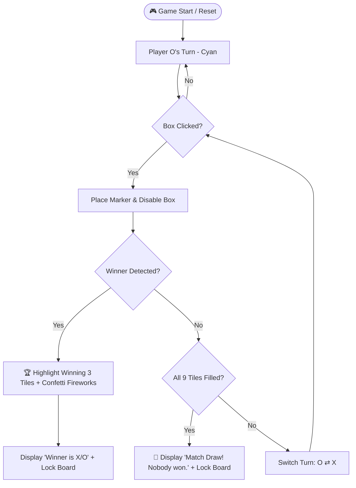

<div align="center">

# 🎮 TIC-TAC-TOE
### *Cyberpunk Neon Gaming Edition*


<p align="center">
  A futuristic, high-performance, and responsive <b>Tic-Tac-Toe</b> web game built with vanilla technologies and styled with modern <b>Tailwind CSS</b>. Experience smooth micro-interactions, dynamic neon highlights, live turn tracking, celebratory fireworks, and 100% vector SVG icons.
</p>

[✨ Key Features](#-key-features) •
[🕹️ Live Gameplay](#️-live-gameplay--ui-preview) •
[🎨 Design System](#-color-palette--design-system) •
[🚀 Quick Start](#-quick-start) •
[🧠 Game Logic](#-game-logic--architecture) •
[🗺️ Roadmap](#-future-roadmap)

---

</div>

<br/>

## 🕹️ Live Gameplay & UI Preview

```text
 ┌────────────────────────────────────────────────────────┐
 │                      TIC TAC TOE                       │
 │               [ ● Turn: Player O (Cyan) ]              │
 ├────────────────────────────────────────────────────────┤
 │                                                        │
 │        ┌──────────────┬──────────────┬──────────────┐  │
 │        │      O       │      X       │      O       │  │
 │        │ (Neon Cyan)  │(Neon Fuchsia)│ (Neon Cyan)  │  │
 │        ├──────────────┼──────────────┼──────────────┤  │
 │        │      X       │      O       │      X       │  │
 │        │(Neon Fuchsia)│ (Neon Cyan)  │(Neon Fuchsia)│  │
 │        ├──────────────┼──────────────┼──────────────┤  │
 │        │      O       │              │              │  │
 │        │ (Neon Cyan)  │   [Empty]    │   [Empty]    │  │
 │        └──────────────┴──────────────┴──────────────┘  │
 │                                                        │
 │            [ 🔄 Reset Game ]    [ ▶️ New Game ]        │
 └────────────────────────────────────────────────────────┘
```

---

## ✨ Key Features

| Feature | Description |
| :--- | :--- |
| 🌌 **Cyberpunk Aesthetic** | Radial cosmic gradient with ambient purple and cyan background glow orbs. |
| ⚡ **Pure Tailwind CSS** | Powered by Tailwind CDN with custom keyframes—no legacy `style.css` files needed. |
| 📱 **Zero-Distortion Responsive** | Utilizes dynamic `aspect-square` geometry and `min(90vw, ...)` fluid bounds for iPhone, Android, iPad, and 4K displays. |
| 🎯 **Live Turn Indicator** | Real-time status pill displaying the active player with an animated pulsing indicator. |
| 🏆 **Algorithmic Winner Check** | Real-time evaluation across all 8 win patterns with glowing tile rings and dual-side confetti fireworks. |
| 🤝 **Intelligent Draw Detection** | Automatically identifies stalemates and displays a sleek metallic match-draw banner. |
| 📐 **100% Pure SVG Graphics** | Replaced all generic text emojis with crisp, resolution-independent SVG vector graphics. |
| ⚡ **Touch-Optimized** | Integrated `touch-manipulation` eliminates the standard 300ms mobile browser tap delay. |

---

## 🎨 Color Palette & Design System

The visual theme is inspired by modern competitive gaming and arcade interfaces:

```
[ Canvas Dark ]       #0b0f19   (Deep cosmic slate background)
[ Indigo Base ]       #1e1b4b   (Ambient radial lighting)
[ Player O (Cyan) ]   #22d3ee   (Electric Cyan with glow drop-shadow)
[ Player X (Fuchsia)] #e879f9   (Neon Fuchsia with glow drop-shadow)
[ Winner Accent ]     #fbbf24   (Celebratory gold border & ring)
[ Controller Blue ]   #06b6d4   (Action button gradient)
```

---

## 🧠 Game Logic & Architecture



---

## 🚀 Quick Start

This project requires **zero dependencies** and **no build step**. You can run it instantly on any computer.

### Method 1: Instant Direct Launch
1. Clone or download this repository:
   ```bash
   git clone https://github.com/your-username/Tic-tac-Toe.git
   ```
2. Double-click `index.html` to open it in your default browser.

---

### Method 2: Local Development Server

#### Option A: VS Code Live Server
- Open the project folder in **Visual Studio Code**.
- Right-click `index.html` and select **"Open with Live Server"**.

#### Option B: Python 3
```bash
python -m http.server 3000
# Open http://localhost:3000 in your browser
```

#### Option C: Node.js (`npx serve`)
```bash
npx serve .
# Open the URL shown in your terminal
```

---

## 📁 Repository Structure

```tree
Tic-tac-Toe/
│
├── index.html        # Clean semantic HTML5 + Tailwind CSS + Responsive Grid + SVG Icons
├── index.js          # Pure JavaScript game engine, win/draw algorithms & event handling
└── README.md         # Comprehensive project documentation
```

---

## 🎮 How to Play

1. **Start**: The game begins with **Player O**'s turn.
2. **Move**: Click or tap any empty tile on the 3x3 grid.
3. **Alternate**: Turns automatically alternate between **Player O** (Cyan) and **Player X** (Fuchsia).
4. **Victory**: The first player to align 3 matching marks horizontally, vertically, or diagonally wins immediately.
5. **Draw**: If all 9 tiles are marked without a winner, a draw is declared.
6. **Restart**: Press **"Reset"** or **"New Game"** at any time to start a fresh match.

---

## 🗺️ Future Roadmap

- [ ] 🤖 Single-player mode with Minimax AI (Unbeatable AI)
- [ ] 🔊 8-bit retro sound effects & celebratory victory chimes
- [ ] 📊 Persistent score counter (Win / Loss / Draw stats saved to `localStorage`)
- [ ] 🌐 Multiplayer online room creation via WebRTC or WebSockets

---

## 📄 License

Distributed under the **MIT License**. See `LICENSE` for more information.

<div align="center">
  <sub>Crafted with passion for clean code and modern web design. 🚀</sub>
</div>
